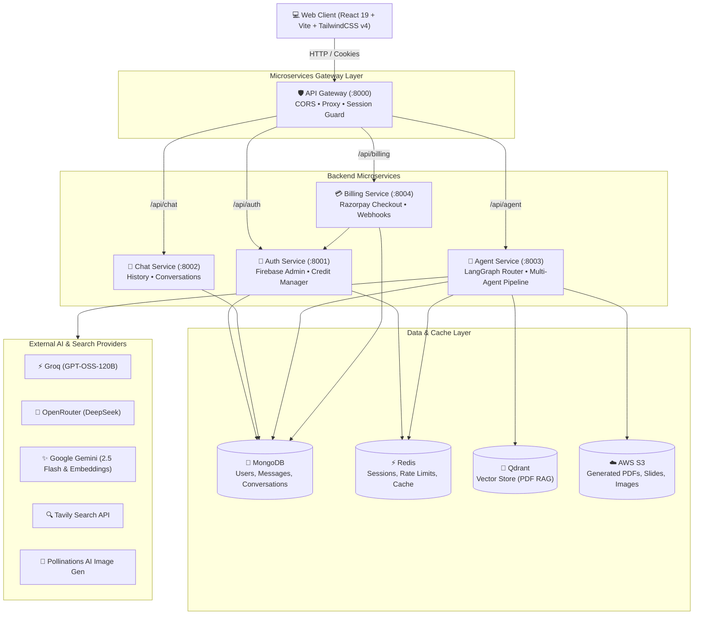

# Setu AI (Cortex AI) 🧠⚡

<p align="center">
  <strong>An Autonomous Multi-Agent AI Orchestration Platform Powered by Microservices, LangGraph, and Modern Generative AI</strong>
</p>

<p align="center">
  
  
  
  
  
  
  
  
  
</p>

---

## 📌 Table of Contents

- [Overview](#-overview)
- [System Architecture](#-system-architecture)
- [Agent Ecosystem & Capabilities](#-agent-ecosystem--capabilities)
- [Tech Stack](#-tech-stack)
- [Repository Structure](#-repository-structure)
- [Getting Started](#-getting-started)
  - [Prerequisites](#prerequisites)
  - [Option 1: Quickstart with Docker Compose (Recommended)](#option-1-quickstart-with-docker-compose-recommended)
  - [Option 2: Local Manual Setup](#option-2-local-manual-setup)
- [Environment Variables](#-environment-variables)
- [API Reference](#-api-reference)
- [Production Deployment](#-production-deployment)
- [Troubleshooting & FAQs](#-troubleshooting--faqs)

---

## 📖 Overview

**Setu AI** (internally *Cortex AI*) is an enterprise-ready, scalable AI workspace that combines a reactive front-end with an asynchronous microservices backend. It leverages **LangGraph state machines** to intelligently route user queries to specialized AI agents for:

- 💬 **Conversational AI**: High-throughput reasoning and dialogue via Groq LPU acceleration.
- 🌐 **Real-Time Web Search**: Grounded information retrieval with Tavily search and live citations.
- 💻 **Interactive Code Generation**: Multi-file code generation and artifacts displayed directly in Monaco Editor.
- 📄 **Automated Document Synthesis**: On-the-fly PDF and PowerPoint (`.pptx`) generation uploaded to AWS S3.
- 🔍 **Document RAG Intelligence**: Deep vector semantic search on uploaded PDF documents via Qdrant and Gemini Embeddings.
- 🖼️ **Multimodal Vision & Generation**: Image prompt synthesis via Pollinations AI and image comprehension via Gemini 2.5 Flash.
- 💳 **Monetization & Quota Management**: Credit metering, rate limiting, and subscription upgrades powered by Razorpay.

---

## 🏗️ System Architecture



---

## 🤖 Agent Ecosystem & Capabilities

Setu AI's Agent service evaluates incoming prompts and attached files with a dynamic LangGraph supervisor:

| Agent | Trigger / Intent | Core Model / Engine | Credit Cost | Rate Limit | Output |
| :--- | :--- | :--- | :--- | :--- | :--- |
| **Chat** | General discussion, Q&A | Groq `openai/gpt-oss-120b` | 1 credit | 20 req/min | Markdown text |
| **Search** | Real-time queries, news | Tavily Search + Groq | 5 credits | 5 req/min | Live search results + images |
| **Coding** | Code snippets, full apps | OpenRouter `deepseek/deepseek-chat` | 10 credits | 5 req/min | Monaco code artifact |
| **PDF Gen** | Create reports, documents | Groq + `pdfkit` + AWS S3 | 10 credits | 5 req/min | Downloadable PDF link |
| **PPT Gen** | Generate presentations | Groq + `pptxgenjs` + AWS S3 | 10 credits | 5 req/min | Downloadable `.pptx` link |
| **Vision Gen** | Image generation | Pollinations AI + AWS S3 | 10 credits | 5 req/min | Rendered image + S3 link |
| **PDF RAG** | Upload `.pdf` file | Gemini Embeddings + Qdrant | 10 credits | 5 req/min | Contextual PDF analysis |
| **Image Vision**| Upload image file | Gemini 2.5 Flash | 10 credits | 5 req/min | Multimodal image critique |

---

## 🛠️ Tech Stack

### Frontend
- **Framework**: [React 19](https://react.dev/), [Vite](https://vitejs.dev/)
- **Styling**: [Tailwind CSS v4](https://tailwindcss.com/)
- **State Management**: [Redux Toolkit](https://redux-toolkit.js.org/)
- **Code Editor**: [@monaco-editor/react](https://github.com/suren-atoyan/monaco-react)
- **Animations**: [Motion](https://motion.dev/)
- **Markdown**: `react-markdown`, `remark-gfm`, `react-syntax-highlighter`
- **Auth**: Firebase Web SDK (Google Provider)

### Backend & Microservices
- **Runtime**: [Node.js](https://nodejs.org/) (ES Modules)
- **Framework**: Express 5
- **Orchestration**: [LangChain](https://js.langchain.com/) & [LangGraph](https://langchain-ai.github.io/langgraphjs/)
- **Cache & Sessions**: Redis via [ioredis](https://github.com/redis/ioredis)
- **Database**: MongoDB via [Mongoose](https://mongoosejs.com/)
- **Vector DB**: [Qdrant](https://qdrant.tech/) via `@langchain/qdrant`
- **Cloud Storage**: AWS S3 via `@aws-sdk/client-s3`
- **Payments**: [Razorpay](https://razorpay.com/) SDK

---

## 📁 Repository Structure

```
setu-ai/
├── .github/
│   └── workflows/
│       └── deploy.yml          # AWS ECS + ECR + S3 + CloudFront deployment
├── backend/
│   ├── docker-compose.yml       # Multi-container orchestration (Redis, Mongo, Services)
│   ├── package.json             # Backend scripts & shared dependencies
│   ├── gateway/                 # API Gateway Service (:8000)
│   │   ├── controllers/
│   │   ├── middleware/          # Session cookie authentication via Redis
│   │   ├── utils/               # Express HTTP Proxy decorator
│   │   └── index.js
│   ├── services/
│   │   ├── agent/               # Multi-Agent Orchestration Service (:8003)
│   │   │   ├── agents/          # chat, coding, pdf, ppt, vision, search, pdfRag
│   │   │   ├── config/          # llmModels, embeddings, s3, tavily, vectorDb
│   │   │   ├── graph/           # LangGraph state machine & router
│   │   │   └── utils/           # S3 uploaders, PDF/PPT generators
│   │   ├── auth/                # User & Subscription Service (:8001)
│   │   │   ├── config/          # Firebase Admin & MongoDB
│   │   │   ├── controllers/     # Login, logout, credit deduction, plans
│   │   │   └── models/          # User schema
│   │   ├── billing/             # Payment & Checkout Service (:8004)
│   │   │   ├── config/          # Razorpay client
│   │   │   └── controllers/     # Order creation & signature verification
│   │   └── chat/                # Conversations & History Service (:8002)
│   │       ├── controllers/     # Message persistence & retrieval
│   │       └── models/          # Conversation & Message schemas
│   └── shared/
│       └── redis/               # Resilient Redis client with auto-reconnect
├── frontend/                    # Vite + React 19 Client (:5173)
│   ├── src/
│   │   ├── components/          # ChatArea, Artifact (Monaco), BillingDrawer, SideBar
│   │   ├── features/            # API actions (sendMessage, createOrder, etc.)
│   │   ├── redux/               # Redux slices (user, conversation, message)
│   │   └── utils/               # Axios & Firebase client configs
│   ├── vite.config.js
│   └── package.json
├── package.json                 # Monorepo task runner
├── .env.example                 # Root environment template
└── README.md
```

---

## 🚀 Getting Started

### Prerequisites
- **Node.js**: v20.0.0 or higher
- **npm**: v10.0.0 or higher
- **Redis**: Running locally on `6379` or via Docker
- **MongoDB**: Running locally on `27017` or MongoDB Atlas URI
- *(Optional)* **Docker & Docker Compose**

---

### Option 1: Quickstart with Docker Compose (Recommended)

1. **Clone the repository**:
   ```bash
   git clone https://github.com/bhavya29102006/setu-ai.git
   cd setu-ai
   ```

2. **Configure environment variables**:
   ```bash
   cp .env.example .env
   # Edit .env with your LLM API keys (Groq, Gemini, OpenRouter, Tavily, AWS S3)
   ```

3. **Start all infrastructure and services**:
   ```bash
   docker compose -f backend/docker-compose.yml up -d
   ```

4. **Run the frontend**:
   ```bash
   cd frontend
   npm install
   npm run dev
   ```
   Open [http://localhost:5173](http://localhost:5173) in your browser!

---

### Option 2: Local Manual Setup

#### 1. Start Infrastructure (Redis & MongoDB)
Make sure Redis and MongoDB are running:
```bash
# Using Docker for local databases:
docker run -d -p 6379:6379 --name redis redis:alpine
docker run -d -p 27017:27017 --name mongodb mongo:latest
docker run -d -p 6333:6333 --name qdrant qdrant/qdrant:latest
```

#### 2. Install Dependencies
Run in each service directory (or root):
```bash
# Root & Backend
npm install
cd backend && npm install

# Gateway & Services
cd gateway && npm install && cd ..
cd services/auth && npm install && cd ..
cd services/chat && npm install && cd ..
cd services/agent && npm install && cd ..
cd services/billing && npm install && cd ../..

# Frontend
cd frontend && npm install && cd ..
```

#### 3. Setup Environment Files
Copy the `.env.example` file in each folder to `.env`:
```bash
cp backend/gateway/.env.example backend/gateway/.env
cp backend/services/auth/.env.example backend/services/auth/.env
cp backend/services/chat/.env.example backend/services/chat/.env
cp backend/services/agent/.env.example backend/services/agent/.env
cp backend/services/billing/.env.example backend/services/billing/.env
cp frontend/.env.example frontend/.env
```

#### 4. Launch Services
You can run services individually or in separate terminal tabs:

```bash
# Terminal 1: API Gateway (Port 8000)
npm run start:gateway

# Terminal 2: Auth Service (Port 8001)
npm run start:auth

# Terminal 3: Chat Service (Port 8002)
npm run start:chat

# Terminal 4: Agent Service (Port 8003)
npm run start:agent

# Terminal 5: Billing Service (Port 8004)
npm run start:billing

# Terminal 6: Frontend Client (Port 5173)
npm run dev:frontend
```

---

## 🔑 Environment Variables

### Root / Shared
| Variable | Description | Default |
| :--- | :--- | :--- |
| `MONGODB_URI` | Connection URI for MongoDB | `mongodb://localhost:27017/setu-ai` |
| `REDIS_URL` | Connection URL for Redis | `redis://localhost:6379` |
| `QDRANT_URL` | Connection URL for Qdrant Vector DB | `http://localhost:6333` |

### Agent Service (`backend/services/agent/.env`)
| Variable | Description | Required? |
| :--- | :--- | :--- |
| `GROQ_API_KEY` | Groq LPU API key for fast chat & search routing | **Yes** |
| `GOOGLE_API_KEY` | Google Gemini API key (Vision analysis & Embeddings) | **Yes** |
| `OPENROUTER_API_KEY` | OpenRouter API key for DeepSeek Coding Agent | Optional |
| `TAVILY_API_KEY` | Tavily Search API key for real-time web retrieval | Optional |
| `AWS_REGION` | AWS S3 region for generated artifacts | Optional |
| `AWS_ACCESS_KEY_ID` | AWS S3 Access Key ID | Optional |
| `AWS_SECRET_KEY` | AWS S3 Secret Access Key | Optional |
| `AWS_BUCKET_NAME` | AWS S3 Bucket Name | Optional |

### Billing Service (`backend/services/billing/.env`)
| Variable | Description | Required? |
| :--- | :--- | :--- |
| `RAZORPAY_KEY_ID` | Razorpay Key ID | Optional (Payments) |
| `RAZORPAY_KEY_SECRET` | Razorpay Key Secret | Optional (Payments) |

### Frontend (`frontend/.env`)
| Variable | Description | Default |
| :--- | :--- | :--- |
| `VITE_SERVER_URL` | Base URL for API Gateway | `http://localhost:8000` |
| `VITE_FIREBASE_API_KEY`| Web Firebase API key | Required for Google Auth |
| `VITE_RAZORPAY_KEY_ID` | Razorpay Public Key ID | Optional (Payments) |

---

## 📡 API Reference

All requests from the client pass through the **API Gateway** on port `8000`.

### Gateway & Auth (`/api/auth`)
- `POST /api/auth/login`: Authenticate with Firebase ID token, initializes Redis session cookie.
- `GET /api/auth/logout`: Clears Redis session and removes cookie.
- `GET /api/me`: Returns currently authenticated user details, plan, and credit balance.

### Chat & History (`/api/chat`) *(Protected)*
- `POST /api/chat/create-conversation`: Start a new conversation thread.
- `GET /api/chat/get-conversations`: Fetch all user conversations.
- `GET /api/chat/get-messages/:id`: Fetch message history for a conversation.
- `POST /api/chat/save-message`: Persist a new chat message.

### Multi-Agent Pipeline (`/api/agent`) *(Protected)*
- `POST /api/agent/chat`: Send prompt with optional multipart file attachment (`file`).
  - Request body: `{ prompt: string, conversationId: string, agent?: string }`
  - Routes through LangGraph supervisor, invokes selected agent, updates credit balance.

### Billing & Subscription (`/api/billing`) *(Protected)*
- `POST /api/billing/create-order`: Generates a Razorpay payment order.
- `POST /api/billing/verify`: Verifies Razorpay HMAC signature and upgrades plan/credits.

---

## 🌐 Production Deployment

The project includes automated CI/CD via **GitHub Actions** (`.github/workflows/deploy.yml`):

1. **Docker Builds**: Each microservice (`gateway`, `auth`, `chat`, `agent`, `billing`) is containerized via its respective `Dockerfile`.
2. **Amazon ECR**: Images are tagged and pushed to Amazon Elastic Container Registry.
3. **Amazon ECS**: Updates ECS cluster services with zero-downtime rolling deployments.
4. **Frontend S3 & CloudFront**: Vite production bundle is synced to AWS S3 and invalidates CloudFront CDN cache.

---

## 🔧 Troubleshooting & FAQs

#### 1. Why does Auth Service say "Firebase service account key not found"?
Firebase Admin requires service credentials to verify Google OAuth tokens. Place your `serviceAccountKey.json` inside `backend/services/auth/` or export `FIREBASE_SERVICE_ACCOUNT` as an environment variable. If omitted, the service boots in fallback mode for health checks.

#### 2. Redis Connection Warning
Ensure your Redis server is running on `localhost:6379`. The backend includes automatic retry strategies and will reconnect as soon as Redis comes online.

#### 3. Frontend Cannot Connect to Gateway
Verify that `VITE_SERVER_URL` in `frontend/.env` points to `http://localhost:8000` and the gateway process is running.

---

## 📄 License

This project is licensed under the [ISC License](LICENSE).
